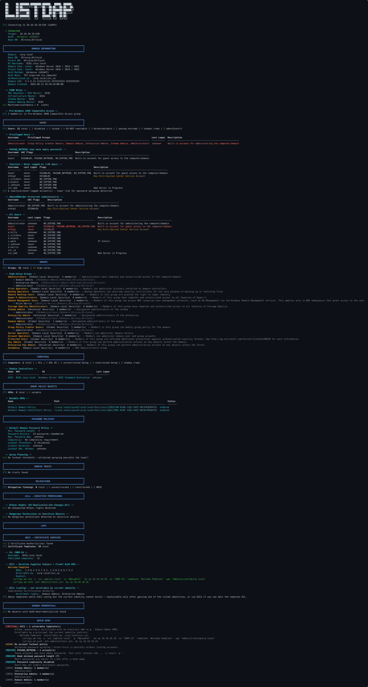

# listdap

LDAP enumeration tool for offensive security assessments, targeting Active
Directory environments. Pure Python 3, authenticated or anonymous.

> ⚠️ **Authorized use only** — see the [Disclaimer](#disclaimer) below.

## Features

- **Authentication** (impacket): signed NTLM (GSS-SPNEGO) and Kerberos via
  ccache / `$KRB5CCNAME` / username+password (pure-Python TGT), with SIMPLE and
  anonymous fallbacks. Works against DCs that enforce LDAP signing / channel
  binding. Automatic domain discovery.
- **Enumeration modules**: domain info & FSMO, users, groups, computers, GPOs,
  password policies (incl. FGPP), trusts, delegations.
- **ACL analysis** (pure-Python security-descriptor parser): DCSync rights and
  dangerous DACLs on sensitive objects, with privileged-principal filtering to
  avoid noise.
- **ADCS / ESC detection**: ESC1, ESC2, ESC3, ESC4, ESC6, ESC7, ESC8, ESC9.
  - Exploitability is assessed **relative to the authenticated identity**
    (its SID + token groups), like `certipy find -vulnerable` — a template is
    only flagged actionable if the current user can actually enroll.
  - ESC7 reads the authoritative CA registry security descriptor over MS-RRP
    (falls back to the CA LDAP object DACL when RRP is unavailable).
  - ESC8 actively probes `/certsrv/` over HTTP/HTTPS for NTLM-relay surface.
  - Findings include **ready-to-run exploitation commands** filled from the
    enumerated data (CA name, template CN, DC, domain, current credentials).
- **LAPS** (legacy + Windows) and **Shadow Credentials** detection.
- **Quick Wins** summary sorted by severity, plus optional user-list dumps.

## Example output

A full scan authenticated as a compromised `svc_ca` account — domain, users,
groups, policies and ACLs — flagging **ESC1** on a template the current
identity can enroll in, with a ready-to-run exploitation command (anonymised):



See **[docs/example-output.md](docs/example-output.md)** for a plain-text version.

## Install

```bash
python3 -m venv venv && source venv/bin/activate
pip install -r requirements.txt
```

No system Kerberos libraries are required — impacket does LDAP signing and
Kerberos (incl. TGT acquisition) in pure Python.

## Usage

```bash
# Anonymous
python3 listdap.py -dc <DC_IP>

# With credentials (auto-discovers domain, Kerberos first, NTLM fallback)
python3 listdap.py -dc <DC_IP> -u <user> -p '<password>'

# Explicit domain, LDAPS
python3 listdap.py -d <domain> -dc <DC_IP> -u <user> -p '<password>' --ldaps

# Kerberos via existing ccache
python3 listdap.py -dc <DC_IP> -u <user> --ccache /tmp/user.ccache

# Specific modules only
python3 listdap.py -dc <DC_IP> -u <user> -p '<password>' --modules users,acls,adcs

# Dump user lists
python3 listdap.py -dc <DC_IP> -u <user> -p '<password>' --dump /tmp/corp

# Verbose
python3 listdap.py -dc <DC_IP> -u <user> -p '<password>' -v
```

## Project structure

```
listdap.py        Entry point, CLI, orchestration
core/             Auth strategies, LDAP connection + rootDSE, output engine
modules/          Per-topic enumeration (domain, users, …, acls, adcs, laps, shadow)
utils/            LDAP helpers, SID resolution, timestamps, UAC, description heuristics
```

## Dependencies

`impacket` only — see `requirements.txt`. Its LDAP client negotiates signing
(NTLM GSS-SPNEGO) and does Kerberos in pure Python, so listdap works against DCs
that enforce LDAP signing / channel binding.

## Notes / limitations

- Subtree searches are paged (1000/page), so large containers are not truncated.
- The security-descriptor parser covers the common ACE types, not every
  inherited/complex structure.
- `lastLogonTimestamp` is replicated and can lag up to ~14 days.
- ADCS ESC5 and ESC10–ESC16 are not currently covered.

## Disclaimer

This tool is provided for **authorized security testing, research, and
educational purposes only** — for example penetration-testing engagements with
written authorization, CTF competitions, and lab environments you own or are
explicitly permitted to assess.

Running it against Active Directory systems **without the explicit, prior
permission of the owner is illegal** and may violate computer-misuse laws. You
are solely responsible for obtaining proper authorization and for complying
with all applicable laws and regulations. The authors and contributors accept
**no liability** for any misuse or damage caused by this software, and provide
it with no warranty (see [LICENSE](LICENSE)).

By using listdap you agree that you have the necessary authorization for any
environment you point it at.

## Versioning

listdap follows [Semantic Versioning](https://semver.org/). The current version
is shown in the banner and via `listdap.py --version`; see
[CHANGELOG.md](CHANGELOG.md) for the revision history.

## License

Released under the [MIT License](LICENSE). © 2026 johnkravicz.
